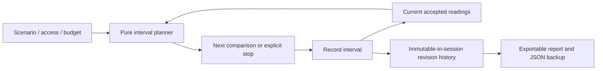

# Trace · by LakeAlive

**Follow the evidence. Make every sample count.**

Trace is a complete browser-based investigation simulator for planning the next useful water sample under a limited budget. Its distinctive interaction is a decision you can inspect and challenge: collect a reading, see which upstream explanations remain compatible, correct the reading, and watch the case reopen.

This is a new, independently implemented prototype for Arham Begani's Xylem project exploration. It is **not field validated**. All map locations, signal bands, measurements, costs and scenarios are fictional. Adaptive sampling is established practice; this project makes no novel-algorithm claim.

## Open it

**No setup:** open `dist/index.html` in a modern browser. It contains the complete app, styles and code, needs no network, API key or account, and makes no background network requests. For reliable browser storage on all browsers, use the local server instead of a `file:` URL. Export JSON regularly; browser storage can be cleared or unavailable. Edit in one tab at a time: this prototype does not merge concurrent local edits from multiple tabs.

**Develop / run locally:** Node 24.15+ (24 LTS), or Node 22.22.2+ (22 LTS).

```sh
npm ci
npm test
npm run evaluate
npm run build
npm run dev
```

Open the localhost URL printed by the dev server. `npm run dev` rebuilds once on startup; rerun `npm run build` and refresh after editing. There are no runtime dependencies. `jsdom` is a development dependency for DOM integration tests.

## A real end-to-end demo

1. Start **A signal upstream**. The fictional reference is low and the lake-entry sample elevated. Seven of eight modeled explanations fit.
2. Choose **Collect this sample**, then **Use the scenario's simulated reading**, then **Save reading**.
3. Follow the recommendations until one modeled explanation remains. If it was inferred by exclusion, follow the explicit **Cross-check** action.
4. Open **Evidence**. Edit a reading or flag it for review. Revisions are retained and the conclusion recalculates.
5. Open **Case settings**. Block a path, mark it unknown, or change the total budget and additional uncertainty allowance. Every change is recorded.
6. Try **When the story breaks**. After the cross-check, the accepted evidence conflicts with every modeled explanation. Trace reports a mismatch instead of a source.
7. Export **Case report** for a readable standalone HTML document (Print → Save as PDF), and **Download backup** for a versioned editable JSON case.

Other scenarios cover multiple branches, access restrictions and wide intervals. Scenario changes and imports ask before replacing the current local case and offer a backup first.

## What works

- Bespoke interactive SVG catchment schematic with keyboard-selectable sites.
- Accessible-site and budget-aware comparison of potential sampling actions.
- Conservative interval compatibility across all eight subsets of three branches.
- A worst-case decision rule with explicit predicted outcome groups; no uncalibrated probability percentages.
- Cross-check of an inferred contributing branch before closing a case.
- Review, mismatch, pending cross-check, changed-conditions, insufficient-budget and inconclusive states.
- Revision history, settings history, local persistence, validated JSON import/export, and escaped evidence report.
- Responsive layouts and reduced-motion styling; all functionality stays in the browser.

## How it works



`src/model.js` knows the network and band assumptions, not hidden scenario outcomes. The simulator and evaluation runner generate readings only after an action has been selected. Imported records are validated and rebuilt from allowed fields. Revisions replace the current value for inference without charging a second sample or erasing earlier versions.

The forward model assumes that any active connected branch produces an elevated signal. It is intentionally simple: it does **not** model dilution, transport, rain, timing, flow, mixing, lab error or environmental thresholds. Model agreement does not establish causation. A source absent from the hypothesis set can still mimic a modeled explanation. The evaluation includes this failure case deliberately.

## Verification and evidence

`npm test` exercises the real calculation and state functions, the standalone build, and the application's DOM event flow. Tests cover conflicting evidence, broad intervals, multiple branches, budget/access enforcement, revision accounting, invalid backups, injection-safe report content, case reload, settings, sample forms, reports and cross-checks.

The synthetic evaluation compares Trace with an accessible fixed A→B→C→J sequence and exact uniform-random sampling over every legal action sequence under identical budgets and access restrictions. [Read the full evaluation](docs/evaluation.md), including its caveats. The generator deliberately contains no field data.

**Browser verification:** Chromium was exercised at desktop size and in 320, 390 and 768 px wide frames. Sampling, invalid input, revisions, reload persistence, keyboard focus, the contradiction/cross-check flow and real backup/report downloads were checked. Narrow views have a larger location selector. See [the browser QA record](docs/browser-qa.md).

**Remaining limits:** native backup restoration could not be completed because the browser tool's file-selection operation hung. Backup parsing and round trips pass automated tests. Physical touch, Safari and Firefox have not been tested. The changed-conditions control is covered by DOM/state tests, not this browser pass. These checks do not establish field validity.

## Structure

- `src/scenarios.js` — network, labels, model version and scenario metadata.
- `src/model.js` — pure compatibility, ranking and stop/cross-check logic.
- `src/state.js` — case transitions, revisions, input and backup validation.
- `src/simulator.js` — synthetic demo outcome generator, separate from the planner.
- `src/map.js`, `src/app.js`, `src/styles.css` — visual interface and interactions.
- `src/report.js` — escaped report and evidence export.
- `scripts/build.mjs` — dependency-free portable bundle.
- `scripts/evaluate.mjs` — deterministic synthetic comparison and stress cases.
- `tests/` — model, state, report, build, evaluation and DOM integration tests.
- `docs/` — scope, plan, development ledger, evaluation and submission preparation.

## Before any real-world pilot

Replace fictional predictions with a validated domain model and a defined sampling protocol. Work with qualified monitoring coordinators on comparable methods, reference sites, temporal assumptions, duplicates, blanks, safe access and actual costs. Obtain observations through authorized field work. Until then, use this as a transparent design prototype and training simulation.

No competition entry, public deployment or GitHub publication was performed. This project was developed with AI assistance; keep an accurate contribution statement when preparing a submission under the event's rules. Third-party development dependencies retain their own licenses. Project licensing is left for its owner to choose.
